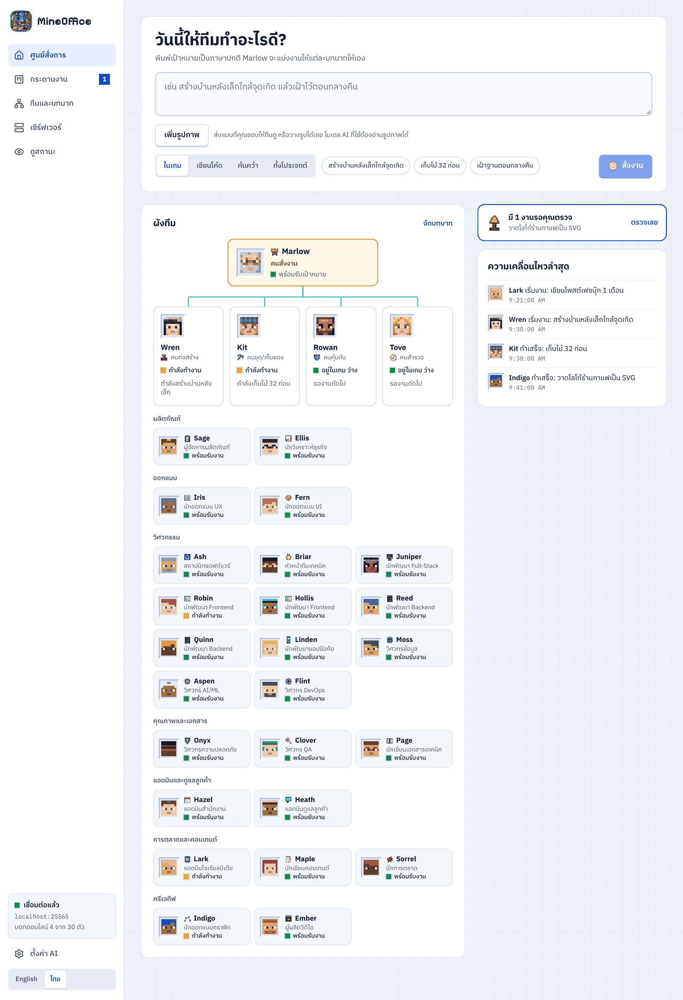
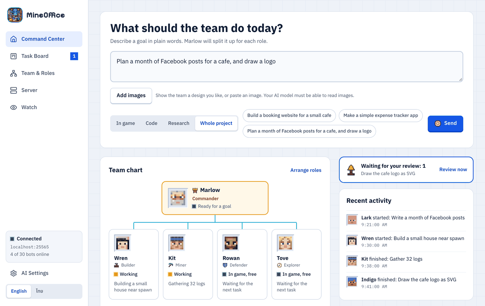
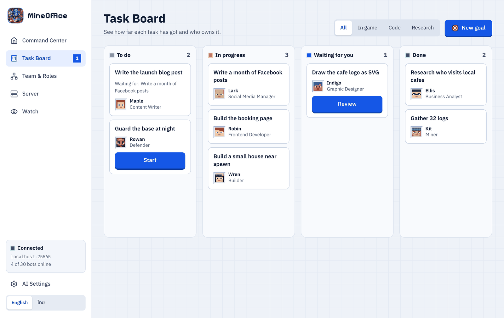
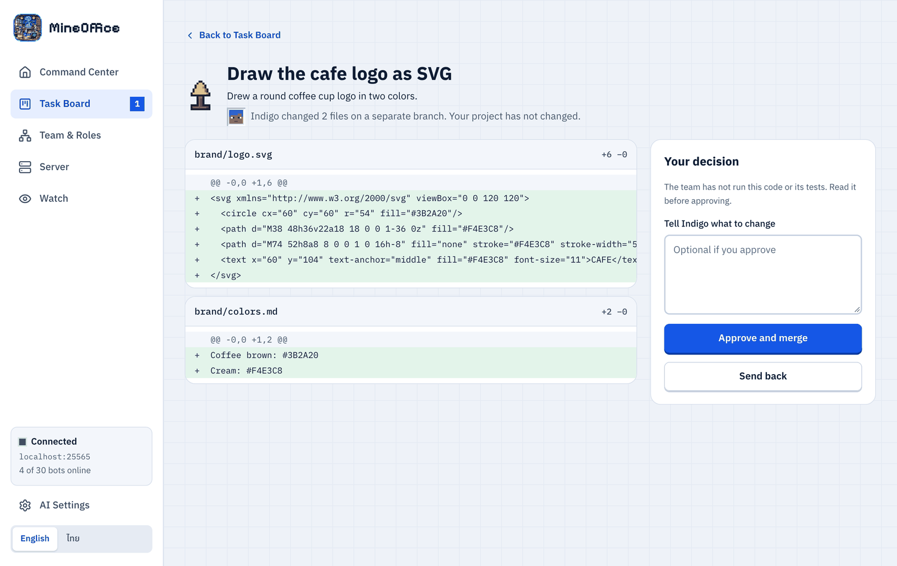
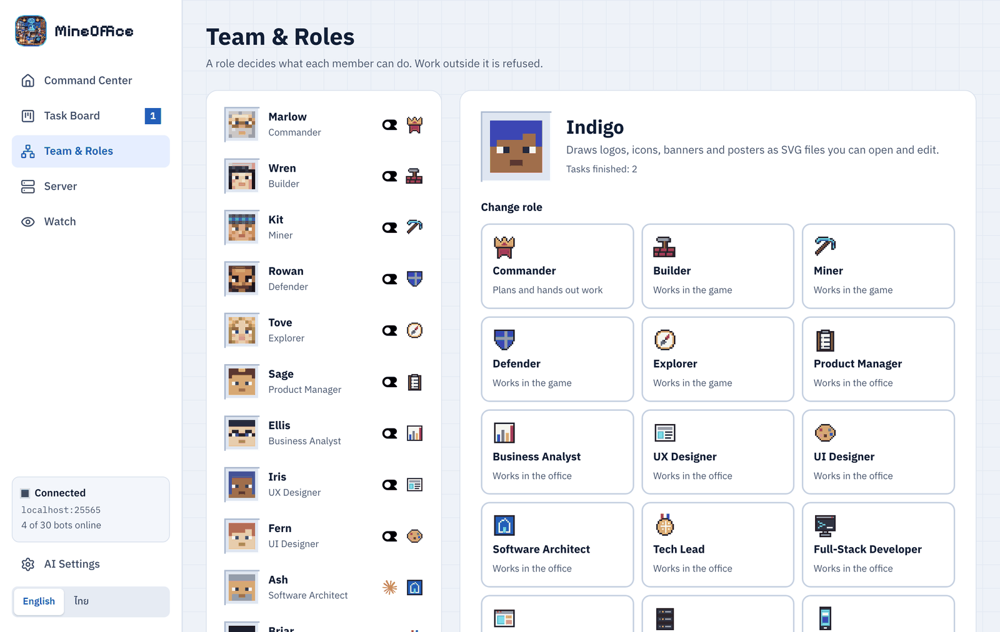

<p align="center"></p>

<h1 align="center">MineOffice Agent</h1>

<p align="center">ทีม AI ที่ทำงานในโลก Minecraft ในโค้ด และในธุรกิจของคุณ<br>สั่งงานเป้าหมายเดียว แล้วทีม 30 คนจะแบ่งงานกันเอง</p>

<p align="center"><b><a href="../../releases">⬇ ดาวน์โหลดสำหรับ Windows, macOS หรือ Linux</a></b></p>

<p align="center">
  <a href="https://github.com/NexwestLedgerCoreCompanyLimited/mineoffice-agent/actions/workflows/ci.yml"></a>
  <a href="../../releases"></a>
  <a href="LICENSE"></a>
  <a href="https://github.com/NexwestLedgerCoreCompanyLimited"></a>
</p>

<p align="center"><a href="README.md">English</a> · ภาษาไทย</p>

<p align="center"></p>

> **สถานะ: 0.2.0 รุ่นทดลองใช้** ทดสอบกับเซิร์ฟเวอร์จำลองแล้ว แต่ยังไม่ได้ทดสอบกับเซิร์ฟ Vanilla หรือ Paper ตัวจริง และยังไม่ได้ทดสอบกับ AI จริงด้วย API key รายละเอียดอยู่ใน[หัวข้อ What has been tested](README.md#what-has-been-tested)

## ทำอะไรได้บ้าง

- **ทั้งบริษัทในโปรแกรมเดียว:** 30 คนใน 9 แผนก ตั้งแต่ผลิตภัณฑ์ ออกแบบ วิศวกรรม คุณภาพ ไปจนถึงแอดมิน การตลาด และครีเอทีฟ
- **ทีมในเกม:** สร้าง ขุด เฝ้า และสำรวจในเซิร์ฟ Minecraft ของคุณ
- **ทีมเขียนโปรแกรม:** แบ่งงานบน Git branch แยก และคุณตรวจของจริงก่อน merge เสมอ
- **งานธุรกิจ:** ตารางงาน คำตอบลูกค้า โพสต์โซเชียล คอนเทนต์ แคมเปญ โลโก้ และสคริปต์วิดีโอ ทีมเตรียมงานให้ แล้วคุณเป็นคนเผยแพร่เอง
- **เลือก AI ได้:** OpenRouter (มีโมเดลฟรี), Google Gemini, Anthropic Claude, OpenAI หรือ Ollama ในเครื่อง และตั้งแยกรายคนได้
- **ตอบสนองไว:** ระบบ reflex 20Hz รับมือการตก ครีปเปอร์ และเลือดน้อยโดยไม่ต้องรอ AI
- **ต่อเครื่องมือภายนอก:** เชื่อม MCP server ได้ และให้ AI ตัวอื่นควบคุม MineOffice ได้
- **หน้าสถานะ:** แชร์ให้คนอื่นดูทีมทำงานได้ โดยดูอย่างเดียว

## ตัวอย่างการใช้งาน

ภาพด้านล่างเป็นแอปจริงที่ใส่ข้อมูลตัวอย่าง

<p align="center"></p>

| ศูนย์สั่งการ | กระดานงาน |
| :--- | :--- |
|  |  |
| **ตรวจงานก่อนรวม** | **ทีมและบทบาท** |
|  |  |

## ดาวน์โหลด

- **แอปเดสก์ท็อป:** โหลดตัวติดตั้ง Windows, macOS (Apple Silicon) หรือ Linux จาก[หน้า Releases](../../releases) ตัวติดตั้งยังไม่ได้เซ็นชื่อ Windows และ macOS จึงจะเตือนตอนเปิดครั้งแรก
- **เซิร์ฟเวอร์ Linux ไม่มีหน้าจอ:** ต้องใช้ Node.js 22 ขึ้นไป

```bash
npm install -g https://github.com/NexwestLedgerCoreCompanyLimited/mineoffice-agent/releases/download/v0.2.0/mineoffice-agent-0.2.0.tgz
```

## เริ่มใช้งานครั้งแรก

1. เปิดเซิร์ฟ Minecraft ให้ออนไลน์ก่อน เพราะ MineOffice เข้าเซิร์ฟที่รันอยู่แล้ว แต่ไม่ได้เปิดเซิร์ฟให้
2. ถ้าเป็นเซิร์ฟในเครื่อง ให้ตั้ง `online-mode=false` และ `max-players=40` ใน `server.properties` ก่อนเปิด
3. เปิด MineOffice แล้วใส่ API key ในหน้าตั้งค่า AI โดย OpenRouter มีโมเดลฟรี
4. ที่หน้าเซิร์ฟเวอร์ ใส่ที่อยู่เซิร์ฟ ใส่ชื่อในเกมของคุณในรายการคนสั่งงาน กดทดสอบ แล้วพาทีมเข้าเกม
5. ที่หน้าศูนย์สั่งการ เลือกประเภทงาน พิมพ์เป้าหมาย แล้วกดสั่งงาน
6. ตรวจแผน กดเริ่ม แล้วตรวจผลงานที่กระดานงาน

ตั้ง `online-mode=false` เฉพาะเซิร์ฟในเครื่องหรือวงที่ไว้ใจเท่านั้น และเซิร์ฟสาธารณะหลายแห่งห้ามใช้บอท ควรอ่านกฎก่อน

## สำหรับนักพัฒนา

```bash
npm install
```

```bash
npm run dev
```

```bash
npm test
```

เอกสารฉบับเต็มอยู่ใน [README ภาษาอังกฤษ](README.md) · [Contributing](CONTRIBUTING.md) · [Code of conduct](CODE_OF_CONDUCT.md) · [Security](SECURITY.md) · [Decisions](DECISIONS.md)

## ข้อกฎหมาย

MineOffice ไม่ใช่ผลิตภัณฑ์ทางการของ Minecraft และไม่เกี่ยวข้องกับ Mojang หรือ Microsoft

ใช้[ใบอนุญาต Business Source License 1.1](LICENSE) โดย NEXWEST LEDGER CORE COMPANY LIMITED ใช้งาน ดัดแปลง และหารายได้จากการใช้งานได้ฟรี แต่ห้ามขายตัวโปรแกรม แต่ละเวอร์ชันจะเปลี่ยนเป็น Apache License 2.0 เมื่อครบ 4 ปี เวอร์ชัน 0.2.0 คือวันที่ 5 พฤศจิกายน 2030 ข้อความนี้เป็นเพียงสรุป ข้อความใน LICENSE เป็นตัวตัดสิน

## ผู้สร้าง

<a href="https://github.com/NexwestLedgerCoreCompanyLimited"></a>

**[Nai Natthawut](https://github.com/NexwestLedgerCoreCompanyLimited)** ผู้ก่อตั้ง [NEXWEST LEDGER CORE](https://nexwest.co.th) สร้างในประเทศไทย โดยมี Claude เป็นผู้ช่วยเขียนโค้ด

<br clear="left">
